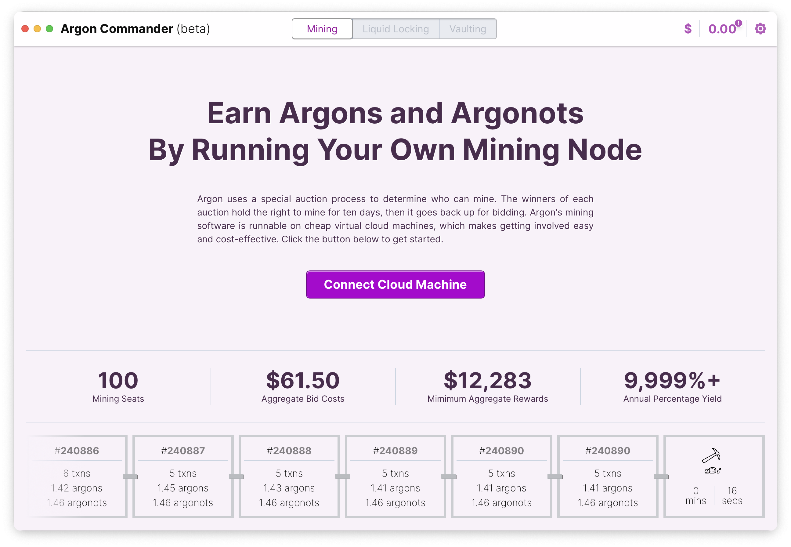
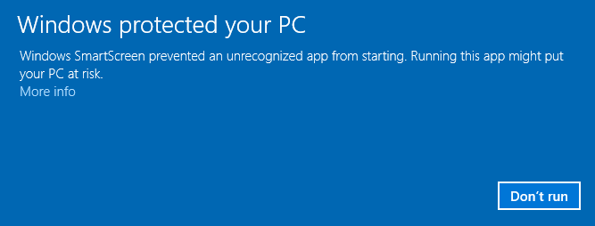

# Argon Apps

This repo contains two desktop applications that helps you interact with the [Argon](https://argon.network) mainchain.
Among the core activities are:

- **Mining**: Argon is a proof-of-authorized-work blockchain. Use the Argonot Operator app to mine Argon tokens.
- **Vaultingt** Run a vault. Earn interest by collateralizing Bitcoin Locks.
- **Liquid Locking** Secure Bitcoins into Vaults to unlock the equivalent Argon liquidity.



## Features

### Mining

Become an Argon Miner, even if you don't know have the technical background to manage a server.

The workflow will help you:

- Provision a mining machine (current providers are [`Digital Ocean`, `Custom Servers`, `Local Docker`])
- Calculate a profitable "bid" amount
- Configure a bidding "bot" to win 1 or more mining seats
- Monitor your bids and earnings

### Vaults

Vaults provide collateralization security to Bitcoin Lockers. As a Vault operator, you are able to set the APR per Argon
for Bitcoin Locks, as well as the percent you're willing to share with Treasury Pool providers (for more details, refer
to the Argon documentation amd white-papers).

Activities:

- Create a Vault
- Cosign Bitcoin Lock release-requests
- Monitor Treasury Pool returns
- Liquid Lock BTC in your Vault

#### Testing Vaults

You can run the docker-compose file that's in the mainchain repository to access bitcoin liquidity to test with (locally). Running this yarn command will download the latest docker-compose from the argon mainchain repository and start it up:

```bash
yarn dev
```

.. This will start bitcoin, a miner, a pricing oracle, and an "esplora" explorer that Argonot Operator uses to track your bitcoin transactions.

You will need the following commands to run against the cli locally:

```bash
# Send bitcoin to the cosign address (replace with your address/amount)
yarn dev bitcoin -- sendtoaddress bcrt1qwyf38ct4yzdd4vqfwa0mtr2qw49n62y8me970737nfea3a7asmhqjcwjfc 0.00039045

# Get a destination address for released bitcoin
yarn dev bitcoin -- getnewaddress

# Broadcast the released bitcoin
yarn dev bitcoin -- sendrawtransaction 020000000001016aa1e38d96312ee99386a13c443bcc38e2c8cb84d55ed779d62...

# Check the status of the bitcoin transaction
yarn dev bitcoin -- gettransaction 020000000001016aa1e38d96312ee99386a13c443bcc38e2c8cb84d55ed779d62...

```

Now you'll want to run Argonot Operator with the environment variable `ARGON_NETWORK_NAME=dev-docker` to connect to the local docker instance.

## Installation

This project has an automated action to build from the source of the project for each release. The action is triggered
by a push to a `version` branch. These releases are guaranteed to match a git hash, so you can see what you're
installing. NOTE: Windows is unsigned, so will require steps to open.

Downloads are available for each "release" on the [releases page](./releases/latest).

### Windows

1. Download the latest windows installer (exe or msi) from the [releases page](./releases/latest).
2. Run the installer
3. You will likely see a screen that says "Windows protected your PC"
   - Click `More info`
     <br/>
4. Click "Run Anyway"
5. Complete the installation

## Building From Source

You can build this project from source by running:

```bash
yarn install
yarn tauri build
```

## Local Docker + E2E

For local mainchain/dev-docker work, keep runtime pinning and e2e in sync:

```bash
yarn mainchain:pin <tag-or-commit>
yarn install
```

Flows are the primary automation path and are documented in [`e2e/README.md`](./e2e/README.md).

Common commands:

```bash
# Desktop with a reusable local Argon/Bitcoin network.
yarn dev

# Desktop on testnet or mainnet; --profile defaults to default.
yarn testnet --profile=me
yarn mainnet --profile=me

# Optional services and account preparation.
yarn dev --start-ethereum --run-upstream
yarn dev --fund-account --operationally-certified
yarn dev --detach-upstream-app

# Standard setup: Ethereum, upstream, certification, and funds on both chains.
yarn dev --full

# Fund the selected account without opening another app.
yarn dev fund --argons 100 --argonots 25
yarn dev fund-ethereum --eth 1 --argons 100 --argonots 25 --usdc 100

# Create an invite to paste into another local app.
yarn dev upstream-invite

# Separate app account sharing the default network.
yarn dev --instance second --join default

# Startup progress appears in the terminal; logs are kept in files.
yarn dev logs
yarn dev status
yarn dev stop
yarn dev reset

# Existing E2E flows retain their own network lifecycle.
yarn e2e:docker
ARGON_E2E_HEADLESS=0 yarn e2e:docker
```

Run `yarn dev --help` for startup options and the command list. Each command owns its arguments and help: use `yarn dev fund --help` or `yarn dev help fund` for native funding options, `yarn dev fund-ethereum --help` for Ethereum funding, and `yarn testnet --help` or `yarn mainnet --help` for public-network launch options. Public-network commands call the desktop launcher directly.

Development tooling lives in `dev/`: `dev/cli.ts` dispatches human commands, `dev/commands/` holds their arguments and help, and the remaining modules provide shared operations and internal setup tools. Startup prepares certificates and downloads pinned Docker assets automatically; CI uses yarn e2e:prepare; E2E and local startup call the shared setup functions. Custom runtime generation is documented separately in `e2e/README.md`.

Funding amounts use whole-token decimal units; explicitly named assets replace the default funding selection of 1,000 ARGN and 1,000 ARGNOT on Argon. Each funding invocation adds the requested amounts. User certification grants operational access using the local-chain shortcut for a fresh profile; existing registered accounts retain their progress and must meet normal activation requirements. The upstream uses a separate account for its vault, delegate, and server setup.

`--full` adds 1,000 ARGN and 1,000 ARGNOT on both Argon and Ethereum, plus 1 ETH for gas. User funding runs after access is granted and does not create a user vault or Bitcoin/bond positions. It uses the selected profile's existing mnemonic for both accounts. Amount flags override each preset amount, including `0` to skip an asset; `--to` and `--eth-to` override recipients.

`fund` adds native Argon assets. `fund-ethereum` requires at least one amount and funds only Ethereum assets; use `--to ADDRESS` to fund an additional wallet imported into the dev user.

Instance names normalize to lowercase with hyphens, matching Docker Compose ownership. Startup reuses local chain and wallet data. `stop` preserves it; `reset` erases the selected owning environment and its attached instances. Development funding and certification are available only for the local dev-docker network.
